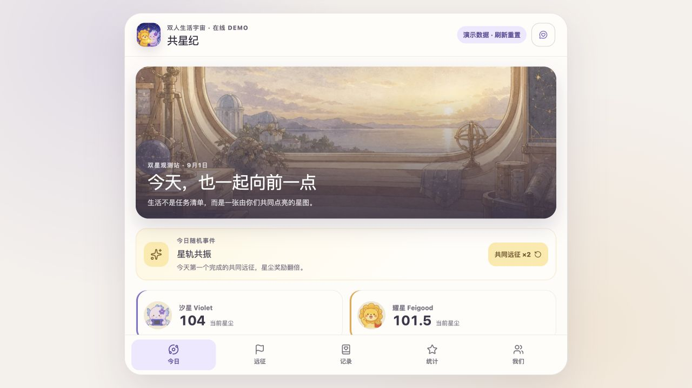

# 共星纪 · 在线 Demo

「共星纪」是一个为汐星 Violet 与耀星 Feigood 设计的双人生活记录与成长游戏原型。

[体验在线 Demo](https://violetloveai.github.io/gongxingji-demo/)



## 可以体验什么

- 在“今日”完成远征，观察星尘变化、角色点赞贴纸与配音反馈。
- 在“远征”切换日常、周常和史诗任务。
- 在“记录”筛选双方记录，并填写一条临时演示记录。
- 在“统计”切换角色、星尘和完成度视图。
- 在“我们”体验星尘兑换与对方见证流程。
- 使用右上角反馈入口整理建议，再复制给子涵或飞哥。

## 演示边界

这是一个无账号、无数据库的交互原型。所有状态只保存在当前浏览器页面中，刷新后会重置。页面不会上传填写内容，也不包含飞书资料或真实私人记录。

部分按钮展示的是后续产品方向，不代表正式功能已经接通。例如每日自动刷新、Apple 私密共享、日历详情和回忆影片生成仍属于正式 App 的开发范围。

## 本地预览

进入仓库目录后启动静态服务器：

```bash
python3 -m http.server 4180 --bind 127.0.0.1
```

然后打开 `http://127.0.0.1:4180/`。

## 仓库内容

```text
.
├── index.html      # 静态入口
├── assets/         # 已构建的 JavaScript 与 CSS
├── gx/             # 角色、场景和配音资源
├── og.webp         # 分享封面
└── preview.png     # 实际运行截图
```

运行时不依赖远程 API、分析服务或第三方字体。复制反馈需要浏览器允许剪贴板访问。

## 使用说明

本仓库仅用于公开预览。未附带开源许可证；角色、美术、音频与代码的再使用权没有通过本仓库授予。
